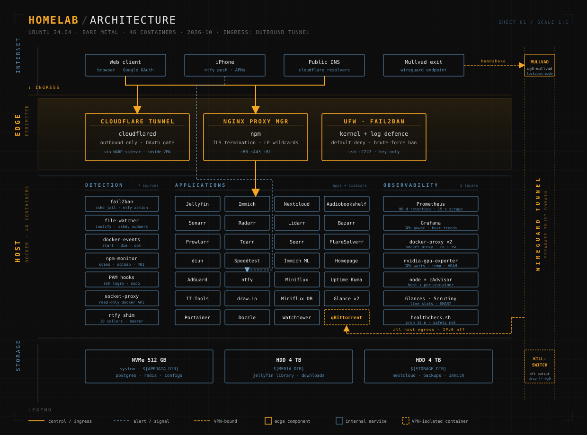
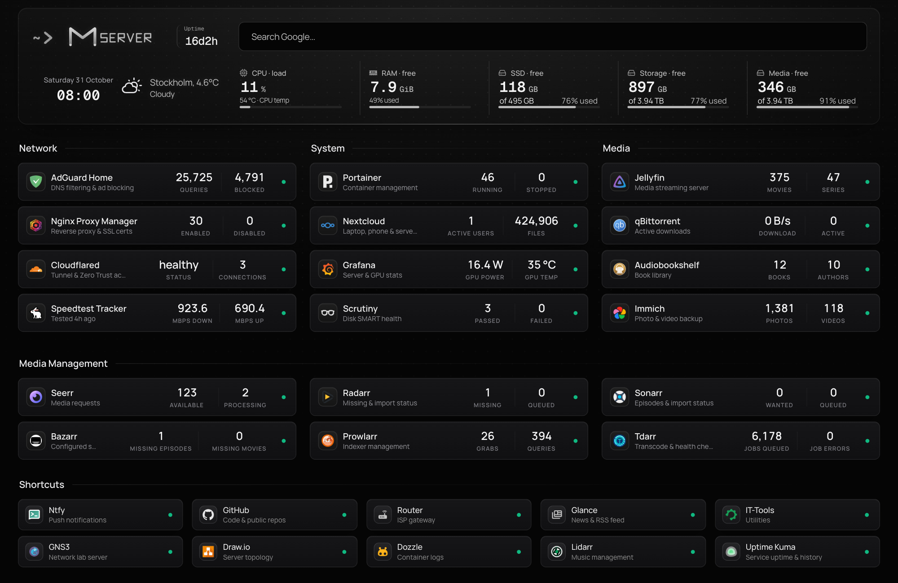
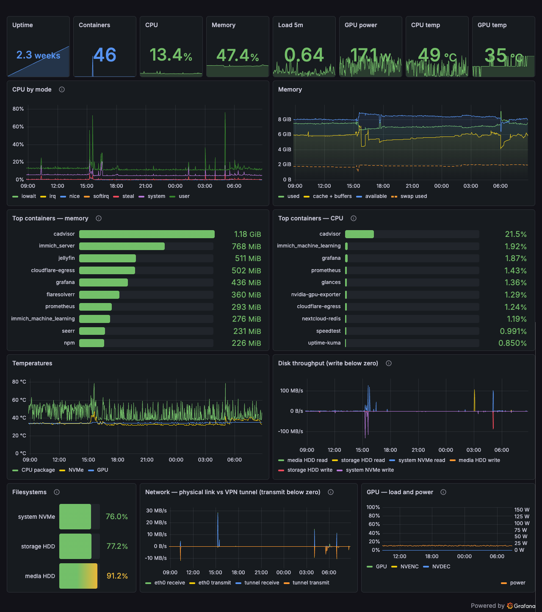
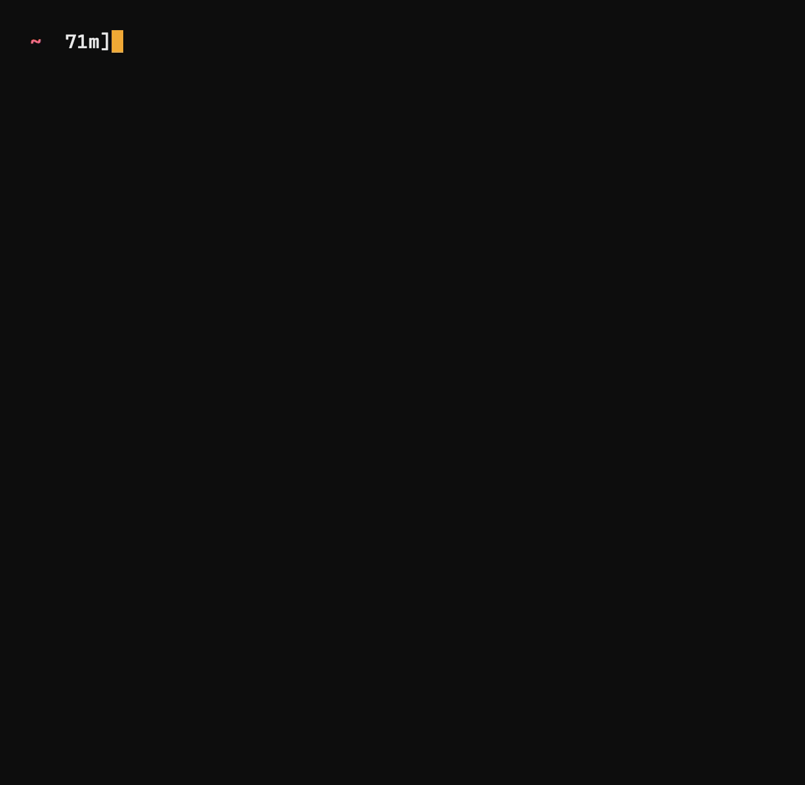

<div align="center">

# Homelab

**Sanitized reference of a real homelab: 46 Docker containers on one bare-metal Ubuntu server, VPN-only egress, tunnel ingress, defense in depth.**

[](https://github.com/MrTorriz/homelab/actions/workflows/lint.yml)
[](LICENSE)
[](docker/README.md)
[](docs/hardware.md)
[](docs/security.md)
[](security/vpn-killswitch.md)

</div>

---

## TL;DR

- **Nothing leaves outside the VPN** — the whole host egresses through Mullvad in lockdown mode, IPv6 is off, and a scheduled check asks an outside service which exit the host *and* the torrent client actually use.
- **No inbound ports** — external access rides an outbound Cloudflare Tunnel behind Cloudflare Access and Google OAuth. The tunnel itself is opened from inside the VPN, through a small WARP sidecar.
- **Defense in depth** — UFW default-deny, fail2ban, `no-new-privileges` on all 46 containers, none privileged, two-tier Docker socket proxy, memory caps on everything that can balloon.
- **Monitoring that reports its own blind spots** — Prometheus/Grafana metrics, 19 event-driven and scheduled ntfy alerters, a 65-check healthcheck every 15 minutes, Uptime Kuma, and a tunnel-health e-mail that still arrives if the host is dead.
- **Backups that have been restored** — nightly archives with database dumps, encrypted off-site copies, and restore drills of all six databases.

### Verified snapshot — 2026-10-31

| | |
|---|---|
| Platform | Bare-metal Ubuntu 24.04.5 · kernel 6.8.0-147 · no hypervisor |
| Containers | 46 running / 0 unhealthy · 0 privileged · 46/46 `no-new-privileges` |
| Docker / Compose | 29.1.3 / 2.40.3 |
| Hardware | i5-9400F · 16 GB · RTX 2060 (NVENC + Immich ML) · NVMe + 2 × 4 TB HDD |
| Storage | `/` 77 % · storage 76 % · media 91 % |
| Egress | Mullvad WireGuard, lockdown mode; host and torrent exits both verified |
| Ingress | Cloudflare Tunnel + Access; no forwarded ports needed |

<sub>Read from the live system on the date above; nothing here updates automatically. What was and was not re-measured: <a href="docs/metrics.md">docs/metrics.md</a>.</sub>

---

> **What this is.** A sanitized public reference of a real, running homelab. The live configuration is the source of truth and lives in a private repository; this repo mirrors it with sensitive hostnames, domains and identifiers replaced. It is not drop-in reproducible — paths, secrets and hardware assumptions belong to one specific box.
>
> **Sanitization policy.** Real internal addresses are never published. Examples use documentation-only values, variables or descriptive labels, and the network topology is generalized. The host's display name *MSERVER* (dashboard logo and login banner) is the sole deliberate machine-name exception. Precise location, domains, account names, MAC addresses, disk serials, device identifiers, VPN relay names, e-mail addresses and the ISP's name are replaced or removed.

## Architecture

<p align="center">
  <a href="docs/img/architecture.svg">
    
  </a><br/>
  <sub>Full topology with trust boundaries, storage paths and observability. Click to open at full size.</sub>
</p>

> **Platform history.** The stack started on this machine as bare-metal Ubuntu, spent June–September 2026 in a VM on a Proxmox host ([proxmox-homelab](https://github.com/MrTorriz/proxmox-homelab)), and was moved back to bare metal with a verified block-level copy of the VM's disk. Why the hypervisor went: [decisions](docs/decisions.md#platform-bare-metal-after-a-hypervisor-detour).

## Engineering notes worth reading

- [**A firewall rule that matched nothing for ten weeks**](docs/lessons-learned.md#a-firewall-rule-that-matched-nothing-for-ten-weeks) — why packet counters beat config review.
- [**The tunnel that could not reach its edge**](docs/lessons-learned.md#the-tunnel-that-could-not-reach-its-edge) — keeping Cloudflare Tunnel inside the VPN when the direct path broke.
- [**A fail-closed guard that closed too late**](docs/lessons-learned.md#a-fail-closed-guard-that-closed-too-late) — when *Connected* is a claim, not a test.
- [**Moving a live system without trusting the move**](docs/lessons-learned.md#moving-a-live-system-without-trusting-the-move) — VM to bare metal, every step provable.

## What runs here

- **Access and network:** Nginx Proxy Manager, cloudflared with its WARP egress sidecar, AdGuard Home and Speedtest Tracker.
- **Dashboards and observability:** Homepage, two Glance themes, Prometheus, Grafana, exporters, cAdvisor, Glances, Scrutiny and Uptime Kuma.
- **Media:** Jellyfin with NVENC, the *arr stack, qBittorrent bound to the VPN, Tdarr, Seerr and Audiobookshelf.
- **Photos and files:** Immich and Nextcloud with their supporting databases and caches.
- **Operations:** Portainer, Dozzle, Watchtower (monitor-only), diun, ntfy and split read-only/read-write Docker socket proxies.

See the full [service catalogue](docker/README.md#service-catalogue) and [observability design](docs/observability.md). `docker/compose.yml` defines 45 services; the 46th container on the live host is a personal service with a private image and is not published.

## Showcase

<p align="center">
  <br/>
  <sub><b>Homepage</b> — sanitized capture of the live dashboard (2026-10-31). Internal addresses and the precise weather location were generalized before capture; the MSERVER display name is deliberately retained. Config: <a href="homepage/">homepage/</a>.</sub>
</p>

<p align="center">
  <br/>
  <sub><b>Grafana</b> — live capture of the Homelab Overview dashboard (2026-10-31, last 24 hours): host, containers, GPU, disks and network on one screen. JSON: <a href="monitoring/grafana/dashboards/homelab-overview.json">homelab-overview.json</a>.</sub>
</p>

<details>
<summary><b>Tooling demos — MOTD, alerting and VPN verification</b></summary>

<br/>

<p align="center">
  <br/>
  <sub><b>MOTD</b> — what an SSH login looks like</sub>
</p>

<p align="center">
  <br/>
  <sub><b>Detection layer</b> — fail2ban status and the event pushes that reach the phone</sub>
</p>

<p align="center">
  <br/>
  <sub><b>Kill-switch check</b> — host and torrent client both exit via Mullvad</sub>
</p>

<p align="center"><sub>Terminal demos rendered with <code>vhs</code> from <code>scripts/demo/</code>, all 2000 px wide at the same font size (2× for high-DPI screens). The MOTD is a fixed snapshot of a real login; ntfy and kill-switch values are synthetic.</sub></p>

</details>

---

## Repo layout

```text
.
├── docker/              # Compose stack (45 services; 46 containers live), .env.example, WARP egress sidecar
├── homepage/            # Homepage config, styles and the two Glance instances
├── scripts/             # healthcheck, VPN checks, backup/, security/, monitoring/, maintenance/, motd/, systemd/
├── security/            # UFW baseline, fail2ban, SSH, sysctl, VPN kill-switch, hardening checklist
├── monitoring/          # Prometheus scrape config, Grafana provisioning and the overview dashboard
├── docs/                # Architecture, security, observability, metrics, runbook, DR, decisions, lessons learned
└── .github/workflows/   # CI: shellcheck, yamllint, markdownlint, gitleaks, compose validation, link + fact checks
```

The repository's social preview is drawn in [`docs/img/social-preview.svg`](docs/img/social-preview.svg), which frames the Homepage capture, and rendered to [`social-preview.png`](docs/img/social-preview.png) at 1280 × 640; [`docs/img/architecture.svg`](docs/img/architecture.svg) is drawn by [`scripts/diagrams/architecture.py`](scripts/diagrams/architecture.py).

## Reusing pieces

Nothing here is meant to be run as-is, but the parts are separable:

```bash
git clone https://github.com/MrTorriz/homelab.git ~/homelab
cd ~/homelab

# Compose stack — needs a filled-in .env and the paths/GPU it assumes
cp docker/.env.example docker/.env && $EDITOR docker/.env
docker network create homelab
(cd docker && docker compose config -q)      # validate before you run anything

# Firewall baseline (idempotent; review LAN_CIDR / ADMIN_IPS first)
sudo bash security/ufw-baseline.sh

# fail2ban jail + ntfy action
sudo cp security/fail2ban/jail.local /etc/fail2ban/jail.local && sudo cp security/fail2ban/action.d/ntfy.conf /etc/fail2ban/action.d/

# Cron + systemd units for the alerters
cat scripts/crontab.example; ls scripts/systemd/
```

> Set `LAN_IFACE` to match your NIC name — `eth0` is a placeholder; modern Ubuntu typically uses `enp*` or `ens*` (`ip -br link`). Firewall rules that name an interface are only as good as that name; see [lessons learned](docs/lessons-learned.md#a-firewall-rule-that-matched-nothing-for-ten-weeks).

External access is opt-in — set up a Cloudflare Tunnel and point it at `npm:443`; the tunnel is outbound-only, so it needs no inbound port on the router.

## Documentation

- [`docs/architecture.md`](docs/architecture.md) — How traffic, storage and trust flow through the host
- [`docs/security.md`](docs/security.md) — Defense-in-depth model + STRIDE analysis
- [`docs/observability.md`](docs/observability.md) — Metrics, events and health, and what is allowed to wake you up
- [`docs/metrics.md`](docs/metrics.md) — Snapshot 2026-10-31: what was measured, how, and what was not
- [`docs/runbook.md`](docs/runbook.md) — Incident playbooks: what to do at 03:00
- [`docs/disaster-recovery.md`](docs/disaster-recovery.md) — RTO/RPO targets, restore tests and procedures
- [`docs/decisions.md`](docs/decisions.md) — Why these tools and not the alternatives
- [`docs/lessons-learned.md`](docs/lessons-learned.md) — What went wrong, why, and what changed
- [`docs/hardware.md`](docs/hardware.md) — Specs, storage layout, GPU role, running cost
- [`SECURITY.md`](SECURITY.md) — How to report a sanitization miss

## License

MIT — fork it, copy bits, learn from it.
