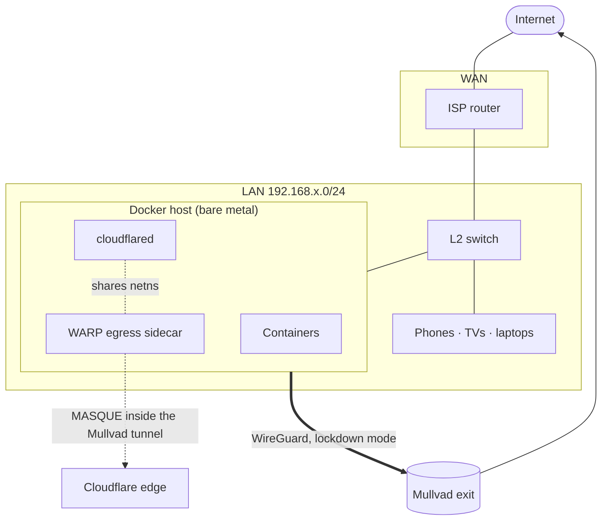
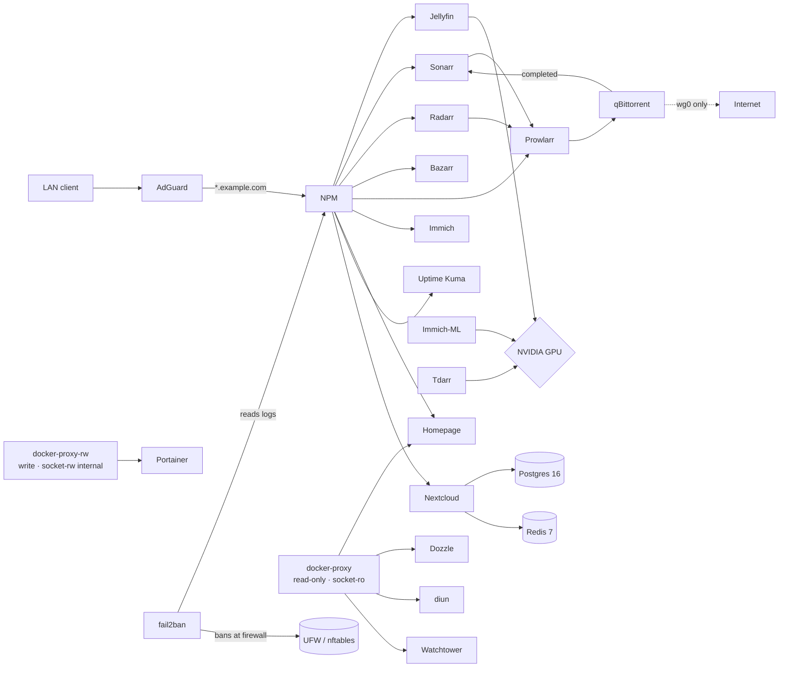
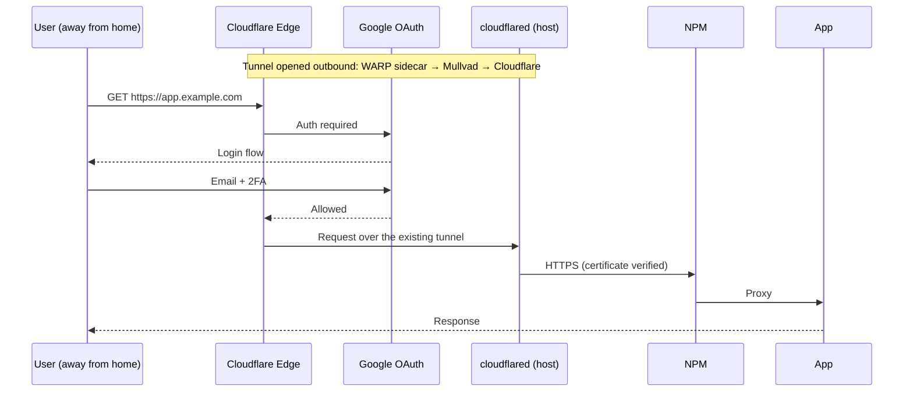

# Architecture

A single bare-metal host with a strong perimeter, VPN-only egress, and a small but consistent set of internal abstractions. Ubuntu runs directly on the hardware; Docker Compose runs the workload. From June to September 2026 the same stack lived in a VM on a Proxmox host — why that layer was removed again is in [decisions](decisions.md#platform-bare-metal-after-a-hypervisor-detour).

## Network topology

**Key properties:**

- **Every packet leaves through Mullvad.** The host runs the Mullvad daemon in lockdown mode with LAN sharing on; the nftables policies for `input`, `output` and `forward` are `drop` for anything that is not LAN or tunnel traffic. If the tunnel drops, the host goes quiet instead of falling back to the ISP.
- **Ingress is an outbound tunnel.** External access rides a Cloudflare Tunnel behind Cloudflare Access + Google OAuth. The tunnel itself is opened from inside the VPN: `cloudflared` shares the network namespace of a small WARP client container, whose encrypted transport in turn runs through the host's Mullvad tunnel — see [`docker/cloudflare-egress/`](../docker/cloudflare-egress/README.md).
- **DNS never touches the ISP.** AdGuard Home serves the LAN; the host itself resolves through the tunnel's resolver so that a stopped AdGuard container can never take the host's own DNS with it.
- **IPv6 is off** on the host (`sysctl`), and verified to have no global address and no route.
- **Torrent traffic is double-bound** — qBittorrent is pinned to the WireGuard interface on top of the host-wide lockdown (see [`../security/vpn-killswitch.md`](../security/vpn-killswitch.md)).

## Storage

Three logical tiers:

| Mount | Type | Purpose |
|---|---|---|
| `/` | NVMe SSD (512 GB) | OS, container runtime, logs, lab images |
| `${APPDATA_DIR}` | NVMe SSD | Container configs and databases (persistent, small files, latency-sensitive) |
| `${MEDIA_DIR}` | 4 TB HDD | Bulk media (movies, series, music, books) |
| `${STORAGE_DIR}` | 4 TB HDD | Photos, downloads, Nextcloud data, transcoder cache, local backup archives |

The data disks are identified by UUID in `fstab`, and the services that write to them only start after a boot guard has confirmed both mounts are present — an empty mount point must never be mistaken for an empty library.

Backups: nightly archive of `${APPDATA_DIR}` with consistent SQL dumps of every database, encrypted off-site copy, weekly off-site copy of system files. Details in [disaster recovery](disaster-recovery.md).

## Service interaction

**Detection vs response, split:** `fail2ban` handles brute-force responses against SSH and NPM logs (it bans IPs); the event-driven scripts push what it and the host are doing to ntfy. The GPU is shared three ways — Jellyfin NVENC, Tdarr NVENC and Immich ML (CUDA) — through the NVIDIA container runtime. Two Docker socket proxies split the blast radius: the read-only one on `socket-ro` serves the dashboards, diun and Watchtower (which only reports available updates), the write-capable one sits on an `internal` network that only Portainer can reach. Nextcloud sits behind NPM with its own Postgres and Redis.

## External access

The tunnel's public hostnames resolve to Cloudflare, never to the home IP, and the tunnel needs no inbound port on the router. Cloudflare sends an e-mail when the tunnel goes down or degrades, which is the one alert that does not depend on the host being alive.

## Why a single host

A multi-host setup would buy redundancy at the cost of operational surface area. For a homelab:

- One box means a small surface: one OS to patch and harden, one cron to maintain, one set of backups to verify. The hypervisor that briefly sat underneath was removed for exactly this reason.
- The host is well within capacity for the workload (CPU rarely above 30 %, GPU only loaded during transcodes and photo indexing). Memory is the tight resource, which is why the heavy services carry `mem_limit` caps.
- Failure mode is acceptable: media is replaceable, photos and documents are backed up off-site, and every service's config is in `${APPDATA_DIR}`, archived nightly.

If this ever needs HA, the cleanest path is a cold spare that can take the latest system image and appdata archive — not an orchestration layer.
